# 🏗️ Multimodal Construction Intelligence Platform
### Skill Wallet Capstone Project 1 • Platform ID: `6ac4c98d1dcde6d7857c1642`
**Category:** Generative AI | Real Estate Decision Support | Civil Engineering

---

## 📌 Executive Summary & Scope

The **Multimodal Construction Intelligence Platform** is an intelligent decision-support system designed for modern construction management, structural forensics, and real estate valuation. It integrates **Multimodal Vision AI (Gemini 1.5/2.5 / Vision LLMs)**, civil engineering codes (**IS 456:2000, IS 875, IS 2925, OSHA 29 CFR 1926**), dynamic weather advisories, and generative 3D architectural synthesis (**Pollinations / Flux**).

---

## 🏛️ System Architecture

```mermaid
graph LR
    subgraph UI ["Client Layer"]
        A["Streamlit Application<br/>(Turnkey UI)"]
        A2["Optional React Web App"]
    end

    subgraph Input ["User Input"]
        B["Site Photos / Crack Images"]
        C["Project Data (Sqft, Tier, Progress)"]
        D["Interactive Queries"]
    end

    subgraph Backend ["Application & API Logic"]
        E["FastAPI Controller<br/>(api.py)"]
        F["Valuation & Material Engine"]
        G["Weather & Safety Engine"]
    end

    subgraph AI ["Multimodal AI & Synthesis"]
        H["Google Gemini Multimodal<br/>(Live API / Demo Simulation)"]
        I["CivAI Engineering Assistant"]
        J["Pollinations AI 3D Synthesizer"]
    end

    subgraph Outputs ["Intelligence Outputs"]
        K["Site Safety & PPE Audit (JSON)"]
        L["Structural Crack Diagnostics (JSON)"]
        M["INR Financial Ledger (Cr / Lakhs)"]
        N["Dynamic Weather Mitigation Protocols"]
    end

    UI --> Input
    Input --> Backend
    Backend --> AI
    AI --> Outputs
    Outputs --> UI
```



---

## 🚀 Key Modules & Epic Coverage

### 🦺 Tab 1: Site Safety & PPE Audit (Epic 2)
- **Visual Inspection:** Accepts construction site photography (JPG/PNG) or built-in sample photos.
- **Multimodal Compliance:** Evaluates worker PPE (hard hats, hi-vis vests, steel-toe footwear, fall arrest harnesses) under **OSHA 1926.95 / 1926.501** and Indian Standards **IS 2925 / IS 3521**.
- **Diagnostic Metrics:** Computes overall `safety_score` (0-100), overall status pill, detected worker count, and flagged hazards categorized by severity (`Low`, `Medium`, `High`, `Critical`) with prescriptive remedies.
- **Data Export:** 1-click downloadable structured JSON report.

### 🔬 Tab 2: Crack Diagnostics & Structural Integrity (Epic 2)
- **Defect Forensics:** Classifies concrete/masonry defects into *Hairline*, *Settlement*, *Structural Shear*, *Thermal Expansion*, or *Spalling & Rebar Corrosion*.
- **Quantitative Estimation:** Estimates crack aperture in millimeters (`mm`), structural risk score (0-100), and validates against **IS 456:2000 Clause 35.3.2** permissible width limits (0.3mm).
- **Engineering Remediation Roadmap:** Step-by-step repair specifications (e.g. low-viscosity epoxy pressure injection, CFRP carbon fiber wraps, structural re-grouting).
- **Export:** 1-click downloadable structural engineering audit report (JSON).

### 📊 Tab 3: Planning & Real Estate Valuation in INR (Epic 3)
- **Interactive Inputs:** Structure classification (Residential High-Rise, Commercial Complex, Industrial Warehouse, Luxury Villa, Affordable Housing), location urban tier (Tier 1, Tier 2, Tier 3), built-up area in sqft, and completion percentage slider.
- **Financial Ledger in INR:** Calculates total construction budget, CapEx disbursed to date, risk-adjusted current market valuation, and projected gross development value in **Crores (₹ Cr) and Lakhs (₹ L)**.
- **Empirical Material Metrics:** Calculates required cement bags (50kg), TMT steel rebar (metric tonnes), aggregate (cu.ft), and labor person-days.
- **Generative 3D Architectural Synthesis:** Integrates **Pollinations AI / Flux** to dynamically synthesize photorealistic 3D conceptual renderings based on structure type, urban tier, and completion phase.

### 🌤️ Tab 4: Daily Site Assistant & Weather-Aware Advisory (Epic 5)
- **Dynamic Weather Protocols:** Real-time safety advisories for *High Wind (>45 km/h)*, *Heavy Rain & Monsoon*, *Extreme Heat (>40°C)*, *Dense Fog*, and *Normal* conditions.
- **Specific Field Protocols:** Automatic crane suspension rules, electrical lockout/tagout, trench dewatering, and concrete curing modifications under **IS 456 Clause 13.5**.
- **CivAI Multi-Turn Chatbot:** Interactive conversational civil engineering consultant specialized in Indian Standards, OSHA, mix design (M20-M50), slump tests, and formwork striking intervals.

---

## 🛠️ Step-by-Step Setup & Installation Guide

### Step 1: Open Terminal in Project Directory
Navigate to the project root:
```bash
cd "C:\Users\yaduv\.gemini\antigravity\scratch\multimodal-construction-platform"
```

### Step 2: Create and Activate a Python Virtual Environment
Creating a virtual environment isolates project dependencies:

**On Windows (PowerShell):**
```powershell
python -m venv venv
.\venv\Scripts\Activate.ps1
```

*(If PowerShell script execution is restricted, run: `Set-ExecutionPolicy -Scope Process -ExecutionPolicy Bypass`)*

**On macOS / Linux:**
```bash
python3 -m venv venv
source venv/bin/activate
```

### Step 3: Install Required Dependencies
```bash
pip install -r requirements.txt
```

### Step 4: (Optional) Configure Gemini API Key
The platform contains a **Graceful Demonstration Fallback Engine**. You can run and test **every single feature immediately without an API key**.

If you wish to use live Google Gemini multimodal vision:
1. Get a free API key from [Google AI Studio](https://aistudio.google.com/).
2. Copy `.env.example` to `.env`:
   ```bash
   cp .env.example .env
   ```
3. Set your API key in `.env`:
   ```env
   GEMINI_API_KEY=AIzaSy...
   ```
*(Or enter it securely directly into the app sidebar at runtime!)*

---

## 💻 Running the Application

### Option A: Run the Turnkey Streamlit Platform (Recommended)
Launch the complete interactive web application:
```bash
streamlit run app.py
```
Streamlit will automatically open your browser at:
👉 **`http://localhost:8501`**

---

### Option B: Run the FastAPI Microservice Backend (Image 2 Architecture)
If you wish to run the decoupled FastAPI REST backend:
```bash
uvicorn api:app --reload --port 8000
```
- Interactive Swagger / OpenAPI Documentation: 👉 **`http://localhost:8000/docs`**
- Alternative ReDoc Documentation: 👉 **`http://localhost:8000/redoc`**

Available Endpoints:
- `POST /api/v1/safety-audit`: Multipart image upload for PPE & hazard audit.
- `POST /api/v1/crack-diagnostics`: Multipart image upload for concrete defect classification.
- `POST /api/v1/valuation`: Project parameters to compute INR ledger & 3D render URL.
- `GET /api/v1/weather-advisories`: List all meteorological mitigation protocols.
- `POST /api/v1/chat`: Multi-turn conversational engineering query.

---

## 🧪 Running Automated Unit Tests

To verify financial calculations, INR formatting, sample generation, and JSON schemas:
```bash
python tests/run_tests.py
```

Expected output:
```text
..
----------------------------------------------------------------------
Ran 2 tests in 0.039s

OK
```

---

## ☁️ 1-Click Cloud Deployment (Streamlit Community Cloud)

1. Push this project folder to your GitHub repository.
2. Visit [share.streamlit.io](https://share.streamlit.io/) and log in with GitHub.
3. Click **"New App"**:
   - **Repository:** `your-username/multimodal-construction-platform`
   - **Branch:** `main`
   - **Main file path:** `app.py`
4. In **Advanced Settings**, add the secret:
   ```toml
   GEMINI_API_KEY = "your-api-key-here"
   ```
5. Click **"Deploy"**! The application will go live with an HTTPS URL in under 2 minutes.

---

## 📁 Repository Directory Structure

```text
multimodal-construction-platform/
│
├── app.py                      # Streamlit Turnkey Application (Epics 2, 3, 4, 5, 6)
├── api.py                      # FastAPI Backend microservice (REST /docs)
├── requirements.txt            # Production dependencies
├── .env.example                # Sample environment configuration
├── README.md                   # Full documentation & setup steps
│
├── modules/
│   ├── __init__.py             # Module package marker
│   ├── gemini_client.py        # Gemini Multimodal client with Demonstration Mode fallback
│   ├── safety_audit.py         # Epic 2: PPE Vision analysis & OSHA/IS hazard checks
│   ├── crack_diagnostics.py    # Epic 2: Concrete crack classification & repair roadmap
│   ├── valuation_engine.py     # Epic 3: INR valuation, material metrics & 3D render generator
│   ├── weather_advisor.py      # Epic 5: Meteorological safety protocols & curing rules
│   ├── chatbot.py              # Epic 5: CivAI multi-turn engineering conversational agent
│   └── sample_data.py          # Synthetic visual inspection reference images for 1-click test
│
└── tests/
    ├── __init__.py
    ├── test_engines.py         # Test definitions
    └── run_tests.py            # Automated test runner
```

---

## 👨‍💻 Project Metadata
- **Project Title:** Multimodal Construction Intelligence Platform
- **Skill Wallet Capstone:** Project 1
- **Platform ID:** `6ac4c98d1dcde6d7857c1642`
- **Applicable Standards:** IS 456:2000, IS 875 (Parts 1-5), IS 2925, IS 3521, OSHA 29 CFR 1926
